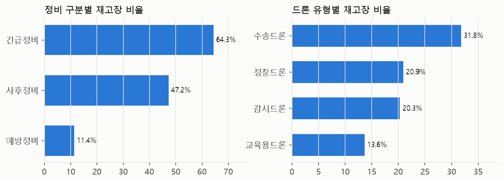
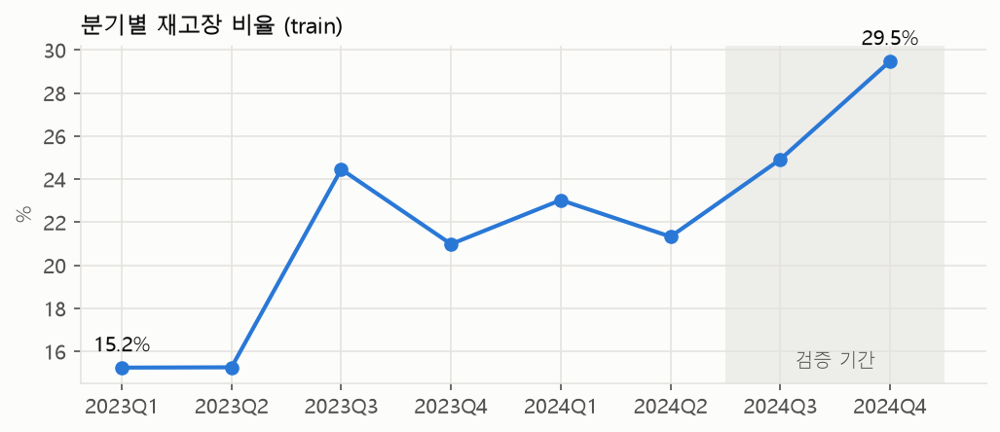
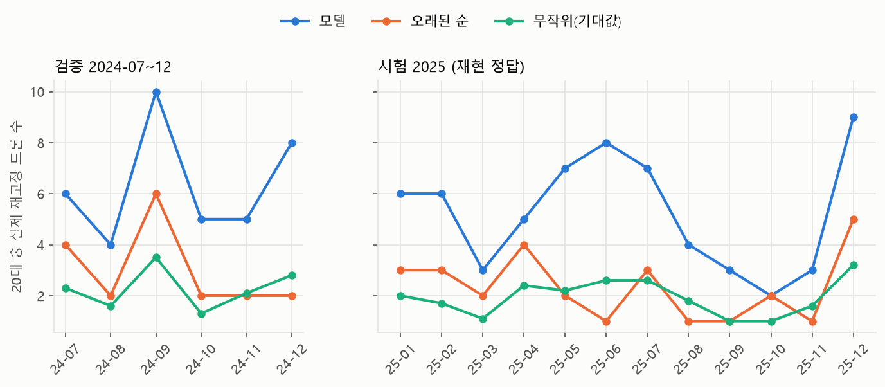
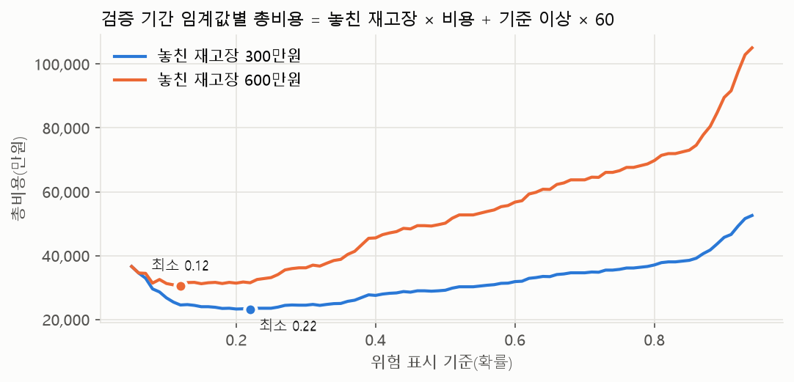
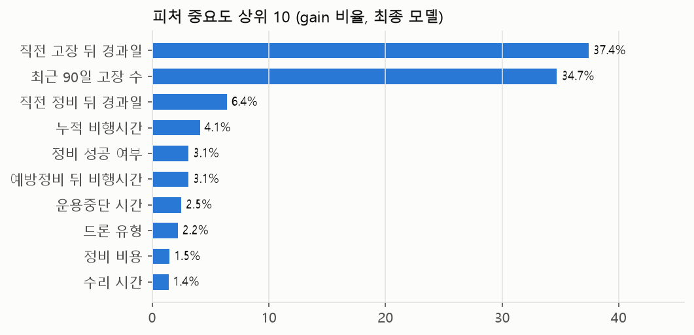

# 드론 30일 안 재고장 예측 — 분석 보고서

생성: `python .claude/skills/drone-report/scripts/report.py` · 교육용 가상 데이터 · 모든 숫자의 출처 파일을 괄호에 적음

## 요약

- 정비 직후 정보만으로 30일 안 재고장 확률을 매기는 LightGBM 모델을 만들었다(`artifacts/model_card.json`).
- 검증 기간 PR-AUC 0.776로 기준선 0.274의 약 2.8배, 재현 정답으로 본 2025 시험 기간 PR-AUC 0.741(기준선 0.236)다(`artifacts/evaluation.json`).
- 매달 20대를 고르면 2025년 12개월 동안 모델 63건, 오래된 순 28건, 무작위 23.2건의 재고장을 미리 잡는다(`artifacts/evaluation.json`).
- 위험 표시 기준은 검증 기간 비용 최소인 0.22(놓친 재고장 300만원). 600만원이면 0.12로 내려간다(`artifacts/model_card.json`).
- 2026-01에는 81대 중 33대가 기준을 넘어, 확률 순 20대를 재점검하고 나머지 13대는 다음 달 우선 대상으로 둔다(`artifacts/score_2026-01.csv`).

| 지표 | 검증 2024 하반기 | 시험 2025(재현 정답) | 기준선 |
|---|---|---|---|
| PR-AUC | 0.776 | 0.741 | 0.274 / 0.236 (재고장 비율) |
| ROC-AUC | 0.879 | 0.849 | 0.5 |
| 월 20대 적중 합(드론 단위) | 38 (6개월) | 63 (12개월) | 오래된 순 18 / 28 · 무작위 13.6 / 23.2 |
| 재고장 드론 중 잡은 비율 | 68% | 66% | 재고장 드론 56 / 96대 |

## 1. 분석 목적

정비를 마친 드론 가운데 30일 안에 다시 사후 · 긴급정비를 받을 드론을 미리 골라, 한 달 20대의 재점검 여력을 가장 효과적으로 쓰는 것이 목적이다. 재고장을 놓치면 1건에 300만원, 재점검은 1대에 60만원이 든다고 가정한다(README).

## 2. 데이터와 주요 패턴

train 2,346건(드론 150대), test 1,241건(2025, 정답 없음), 이번 달 106건(2026-01)이다. train 전체 재고장 비율은 22.4%다(`reports/eda_summary.md`).

**무엇을 보여 주는가** — 정비 구분과 드론 유형에 따라 30일 안 재고장 비율이 얼마나 다른지 보여 준다. 긴급정비 64.3% · 사후정비 47.2% · 예방정비 11.4%, 수송드론 31.8% · 교육용드론 13.6%다.

**왜 중요한가** — 고장 때문에 들어온 정비(사후 · 긴급)는 예방정비보다 재고장 비율이 약 4.1 ~ 5.6배 높다. 정비 구분이 강한 단서이고, 유형 중에는 수송드론이 31.8%로 가장 높다(무거운 짐을 싣는 운용 부하 영향으로 추정).

**그래서 무엇을 하는가** — 정비 구분 · 드론 유형을 모델 피처에 넣고, 재점검 목록을 볼 때 고장 정비를 마친 수송드론을 우선 확인한다.

**무엇을 보여 주는가** — 분기별 재고장 비율이 15.2%(2023Q1)에서 29.5%(2024Q4)로 올랐다.

**왜 중요한가** — 기간에 따라 재고장 비율이 달라, 앞 기간으로 학습한 모델의 확률이 뒤 기간과 어긋날 수 있다. 검증 기간(회색) 비율 27.4%는 학습(fit) 기간 20.5%보다 높다.

**그래서 무엇을 하는가** — 성능을 반드시 기간 분할로 확인하고, 임계값은 최근 기간(검증)에서 고른다. 한계 항목에 이 추세를 적는다.

그 밖의 패턴(`reports/eda_summary.md` 5장): 배터리 고장은 겨울에 76건으로 가장 많고, 모터 고장 147건 중 74건이 수송드론이다(원인은 저온 · 하중 영향으로 추정). 이를 반영해 계절(season) 피처를 넣었다.

## 3. 데이터 처리 기준과 근거 (README [2])

| 대상 | 건수(train) | 처리 | 근거 |
|---|---|---|---|
| downtime_hours = 999 | 4 | 행 유지, 값만 결측 | 999 다음 큰 값 74.0 → 미입력 표시값 |
| maintenance_cost > 10,000 | 5 | ÷100 | 다음 큰 값 478, 나누면 150~190 → 자릿수 실수 |
| fault_code · fault_category 결측 | 1,707 | "N/A" | 예방정비 행과 정확히 일치 → 고장 없음 |
| days_since_last_maintenance 결측 | 150 | 비워 두고 is_first_maintenance=1 | 드론별 첫 정비 → 직전 정비 없음 |
| 행 삭제 | 0 | 하지 않음 | 처리 전후 행 수 동일(preprocess_log) |

**무엇을 보여 주는가** — 이상치 2종과 결측 2종을 어떻게 처리했는지, 왜 그렇게 판단했는지를 보여 준다(`reports/preprocess_log.md`).

**왜 중요한가** — 결측을 최빈값으로 채우면 예방정비에 가짜 고장 코드가 붙고, 999를 그대로 두면 운용중단 시간이 크게 왜곡된다. 행을 지우면 드론별 시간 피처의 흐름이 끊긴다.

**그래서 무엇을 하는가** — 같은 기준을 train · test · 이번 달에 한 함수(`drone_lib.clean`)로 똑같이 적용한다. test · 이번 달에는 이상치가 없었다.

## 4. 피처와 넣지 않은 컬럼 (README [3] · [4])

모델 피처 17개: equipment_type, maintenance_type, fault_category, season, equipment_age_years, severity, downtime_hours, repair_duration_hours, parts_replaced_count, maintenance_cost, maintenance_success, cumulative_operating_hours, days_since_last_maintenance, is_first_maintenance, fail_count_90d, days_since_last_failure, hours_since_last_pm (`drone_lib.FEATURES`).

시간 피처 3개(최근 90일 고장 수 · 직전 고장 뒤 경과일 · 예방정비 뒤 비행시간)는 그 정비일까지의 기록만 보고, train → test → 이번 달을 이어서 계산했다. 다른 방식으로 다시 세어 불일치 0건을 확인했다(`reports/features_log.md`).

| 넣지 않은 컬럼 | 이유 |
|---|---|
| availability_rate | 그 달 전체 가동률 — 정비 직후에는 알 수 없음(누수), 이번 달 데이터에도 없음 |
| equipment_id | 식별자 — 드론 번호를 외우게 됨 |
| unit_code | 식별자(부대) — 부대 번호를 외우게 됨 |
| maintenance_date | 날짜 자체는 넣지 않음 — 계절(season)과 시간 피처로 대신함 |
| fault_code | 고장 코드는 세부 코드라 종류가 많음 — fault_category로 대신함 |

**왜 중요한가** — `availability_rate`는 그 달 전체 가동률이라 정비 뒤 고장이 반영된 값이다. 넣으면 검증 성능은 좋아 보이지만 이번 달 파일에는 없어 실제로 쓸 수 없다(누수).

## 5. 기간 분할과 성능 (README [5])

| fit | val | final_train | test |
|---|---|---|---|
| ~ 2024-06-30 (1,703건) | 2024-07-01 ~ 2024-12-31 (643건) | 2023-01-01 ~ 2024-12-31 (2,346건) | 2025 (1,241건, 정답 없음) |

**무엇을 보여 주는가** — 매달 드론별 최근 기록 하나로 확률 상위 20대를 골랐을 때(재점검 계획과 같은 방식) 실제로 30일 안에 재고장 난 드론 수를 모델 · 오래된 순 · 무작위와 비교한다(`artifacts/val_monthly_top20.csv`, `artifacts/test_monthly_top20.csv`). 2025년 재고장 드론 96대 중 63대(66%)를 20대 안에서 잡았다.

참고로 기록 단위로 세면(같은 드론의 여러 정비 기록이 20자리를 함께 차지) 2025년 모델 148 · 오래된 순 65 · 무작위 53.9건이다. 한 드론이 여러 번 세어져 실제 재점검 대수보다 커지므로 판단에는 드론 단위를 쓴다(`artifacts/evaluation.json`).

**왜 중요한가** — 정비반이 실제로 쓰는 방식(한 달 20대)으로 본 성능이다. 2025년 모델 63건은 오래된 순(28건)의 약 2.2배다. 경과연수만으로 고르는 방식보다 더 많은 재고장을 잡는다.

**그래서 무엇을 하는가** — 재점검 순서를 경과연수가 아닌 모델 확률로 정한다. 2025 결과는 README 정의로 재현한 정답 기준이며(train 일치율 100%), 공식 점수는 강사 정답으로 매긴다(`artifacts/evaluation.json`).

## 6. 위험 표시 기준 (README [6])

| 놓친 재고장 비용(만원) | 기준 | 기준 이상 건수 | 놓친 재고장 | 총비용(만원) |
|---|---|---|---|---|
| 150 | 0.350 | 187 | 46 | 18,120 |
| 300 | 0.220 | 245 | 28 | 23,100 |
| 600 | 0.120 | 309 | 20 | 30,540 |

**무엇을 보여 주는가** — 검증 기간에서 기준을 0.05 ~ 0.94로 바꿔 가며 '놓친 재고장 × 비용 + 기준 이상 × 60만원'을 계산한 결과다(`artifacts/model_card.json` threshold_by_miss_cost).

**왜 중요한가** — 놓친 재고장 비용이 300 → 600만원으로 오르면 기준이 0.22 → 0.12로 바뀌고, 기준 이상 건수는 245 → 309건, 놓친 재고장은 28 → 20건이 된다. 재고장 손해가 클수록 더 넓게 잡는 것이 싸다.

**그래서 무엇을 하는가** — 운영 기준은 0.22로 두고, 임무 중요도가 높은 시기(손해가 큰 경우)에는 600만원 기준을 쓴다. 기준은 시험 기간(2025)으로 고르지 않았다. 참고로 같은 기준을 2025에 그대로 쓰면 아래와 같다(재현 정답).

| 놓친 재고장 비용(만원) | 기준 | 기준 이상 건수 | 놓친 재고장 | 총비용(만원) |
|---|---|---|---|---|
| 300 | 0.220 | 451 | 64 | 46,260 |
| 600 | 0.120 | 543 | 47 | 60,780 |

## 7. 무엇이 위험을 올리는가

**무엇을 보여 주는가** — 최종 모델이 판단에 많이 쓴 피처다(`model_card.json` importance_gain).

**왜 중요한가** — 상위 2개는 직전 고장 뒤 경과일 · 최근 90일 고장 수다. 둘 다 지난 기록으로 만든 시간 피처로, 원본 컬럼만으로는 알 수 없는 반복 고장 흐름을 잡아낸다.

**그래서 무엇을 하는가** — 최근 고장이 잦은 드론은 정비 직후에도 재점검 목록에 올린다. 드론별 이유는 재점검 계획의 '위험을 올린 요인'(SHAP)으로 확인한다.

## 8. 2026-01 재점검 계획 요약

자세한 20대 목록 · 권고는 `reports/2026-01_재점검계획.md`. 상위 5대(`artifacts/score_2026-01.csv`):

| 순위 | 드론 | 유형 | 부대 | 확률 | 위험을 올린 요인 |
|---|---|---|---|---|---|
| 1 | DR-0115 | 수송드론 | UNIT-02 | 94.3% | 최근 90일 고장 11회, 이번 정비가 고장 정비, 정비 실패 |
| 2 | DR-0100 | 수송드론 | UNIT-02 | 81.5% | 이번 정비가 고장 정비, 최근 90일 고장 3회, 정비 실패 |
| 3 | DR-0038 | 정찰드론 | UNIT-10 | 81.1% | 이번 정비가 고장 정비, 최근 90일 고장 5회, 정비 실패 |
| 4 | DR-0046 | 정찰드론 | UNIT-12 | 77.8% | 이번 정비가 고장 정비, 최근 90일 고장 4회, 직전 정비 뒤 경과일 4일 |
| 5 | DR-0017 | 정찰드론 | UNIT-06 | 69.6% | 직전 고장 뒤 1일, 최근 90일 고장 4회, 직전 정비 뒤 경과일 1일 |

## 9. 모델의 한계 (`artifacts/model_card.json` limits)

- 교육용 가상 데이터로 학습했다. 실제 드론 운용에 그대로 쓰지 않는다.
- 학습 기간(2023 ~ 2024)보다 재고장 비율이 오르는 추세여서, 확률 · 기준이 뒤 기간에 낮게 맞을 수 있다.
- 확률은 '정비 뒤 30일' 기준이다. 정비 기록이 없는 드론은 판단하지 않는다.
- 최종 판단은 정비 담당자가 한다. 모델은 재점검 순서를 정하는 참고 자료다.

## 10. 추적 정보 (이 보고서가 어떤 데이터 · 모델 · 결과에서 나왔는가)

파일 내용의 SHA-256 앞 12자리. `python scripts/check.py`가 현재 파일과 다시 대조한다.

| 항목 | 지문 | 기록된 곳 |
|---|---|---|
| 원본 train | 26c4d3711fd5 | model_card.json |
| 원본 test | 5fa789dd8111 | model_card.json |
| 원본 this_month | 379631f03af5 | plan_meta.json |
| 모델 | fa51be49c230 | model_card · plan_meta · evaluation |
| 제출 파일 | 5d5a4ee5dd39 | model_card · evaluation |
| 이번 달 점수 | beb6fc3e9cf1 | plan_meta.json |
